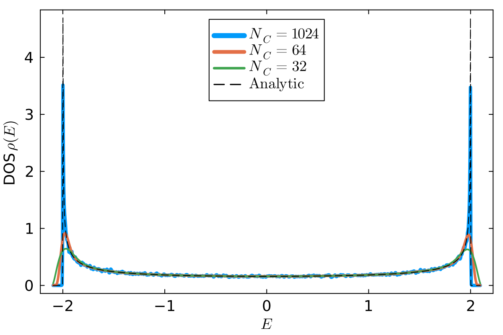

```@meta
CurrentModule = KPMru
```

# KPMru

```@index
```

## Installation

KPMru supports Julia 1.10 and later. Press `]` in the Julia REPL to enter
package mode and choose an installation option.

**From GitHub (available now):**

```text
pkg> add https://github.com/Pixley-Research-Group-in-CMT/KPMru.jl
```

**From the General registry (registration pending):**

[Registration in General](https://github.com/JuliaRegistries/General/pull/175996)
is pending. Once it is merged and your local registry is updated:

```text
pkg> add KPMru
```

Return to Julia mode with Backspace at an empty package prompt, then import:

```@example import_package
using KPMru
nothing # hide
```

Update an existing installation with `pkg> update KPMru`. CPU usage does not
require CUDA.jl; optional, experimental GPU support uses CUDA.jl 5.

For more details see the project's README.

## Quick examples

Every example below is executed during the documentation build. Plotting uses
`Plots` and `LaTeXStrings`; these are included in `docs/Project.toml`, not in the
package's runtime dependencies. To run these examples in your own environment,
install the plotting packages in Julia package mode:

```text
pkg> add Plots LaTeXStrings
```

Each code block is self-contained. The graphene examples load the model shipped
with KPMru using `pkgdir(KPMru)`, so they work outside the repository directory.


### 1) Density of States (DOS) — concise example

```@example dos_quick
using KPMru: normalizeH, kpm_1d, dos, JacksonKernel
using SparseArrays
using Random
using Plots

Random.seed!(1234)

# small 1D tight-binding (periodic)
function tb1dchain(N; t=1.0)
  H = spzeros(ComplexF64, N, N)
  for i in 1:N-1
    H[i,i+1] = -t; H[i+1,i] = -t
  end
  H[1,N] = -t; H[N,1] = -t
  return H
end

N = 1000
NC = 256
NR = 4
H = tb1dchain(N)
# rescale H to (-1,1)
a, Hn = normalizeH(H)
mu = kpm_1d(Hn, NC, NR)
E, rho = dos(mu, a; kernel=JacksonKernel, N_tilde=500)

@assert length(E) == length(rho) == 501 # hide
@assert all(isfinite, rho) # hide
plot(E, rho, xlabel="E", ylabel="DOS", legend=false)
```

#### Full example: comparison with the analytical DOS

This example uses a periodic chain with hopping amplitude `t = 1`, `N = 10_000`
sites, and `NR = 10` random vectors, matching the parameters in the paper's
benchmark caption. Moments are calculated once at `NC = 1024` and reused for
expansion orders 64 and 32. The analytical DOS is the infinite-chain result,
`ρ(E) = 1 / (π * sqrt(4 - E^2))` for `|E| < 2` and zero outside the band.

The following block is self-contained once the packages are installed:

```@example dos_benchmark
using KPMru: normalizeH, kpm_1d, dos, JacksonKernel
using SparseArrays
using Random
using Plots
using LaTeXStrings

Random.seed!(1234)

# Sparse 1D tight-binding Hamiltonian (periodic)
function tb1dchain(N::Integer; t::Real=1.0)
    H = spzeros(ComplexF64, N, N)
    for i in 1:(N-1)
        H[i, i+1] = -t
        H[i+1, i] = -t
    end
    H[1, N] = -t
    H[N, 1] = -t
    return H
end

# Parameters
N = 10_000            # number of sites
NC = 1024             # Chebyshev order
NR = 10               # random vectors for stochastic trace
nE = 1000             # energy intervals (nE + 1 grid points)

H = tb1dchain(N)
# Rescale H -> (-1, 1); b maps energies back to physical units
b, H_norm = normalizeH(H)

# Compute Chebyshev moments (DOS)
mu = kpm_1d(H_norm, NC, NR)    # returns moments (array-like)

# Reconstruct DOS on a grid and map energies back to physical scale
E, rho1024 = dos(mu, b;kernel = JacksonKernel, N_tilde=nE)
E, rho64 = dos(mu[1:64], b;kernel = JacksonKernel, N_tilde=nE)
E, rho32 = dos(mu[1:32], b;kernel = JacksonKernel, N_tilde=nE)

# Analytical DOS 
rho_exact = zeros(length(E))
mask = abs.(E) .< 2
rho_exact[mask] = 1.0 ./ (π * sqrt.(4 .- E[mask].^2))

# plot the DOS
plot(xlabel=L"E", ylabel="DOS"*L"\;\rho(E)",
        legend = :top, 
        framestyle = :box,grid=false,
        xtickfontsize=12, ytickfontsize=12,
        xguidefontsize=12, yguidefontsize=12,
        legendfontsize=12,
        )
plot!(E, [rho1024 rho64 rho32], lw=[4 3 2],label=[L"N_C=1024" L"N_C=64" L"N_C=32"])
plot!(E, rho_exact, c=:black, ls=:dash, label=L"\mathrm{Analytic}")
savefig("dos_convergence.png")
@assert length(E) == nE + 1 # hide
@assert all(isfinite, hcat(rho1024, rho64, rho32)) # hide
@assert isfile("dos_convergence.png") # hide
nothing # hide
```

The figure below is the DOS benchmark figure from the paper. Individual runs
of the example can differ slightly because the trace is estimated using random
vectors. Finite system size, the truncated expansion, and stochastic trace error
account for differences from the analytical curve.



*Paper benchmark: `N = 10_000`, `NR = 10`, and `NC = 32, 64, 1024`.*
[Download the original figure (PDF)](assets/dos_benchmark.pdf).

### 2) Optical conductivity (graphene) — concise example

This small calculation demonstrates the differential two-current contribution at
one frequency and one rescaled energy. It is not an integrated optical spectrum.
The model has hopping amplitude one, so `a = 3.5` safely rescales its spectrum.
The current operators follow the conventions in the supplied graphene model.
The original concise example used `L = 60`, `NC = 256`, and `NR = 6`; the smaller
defaults below are for a quick executable demonstration.


```@example graphene_quick
using KPMru
using Random
include(joinpath(pkgdir(KPMru), "examples", "GrapheneModel.jl"))
Random.seed!(1234)

L = 8
Ham, Jx, Jy, Jxx, Jxy, Jyy = GrapheneLattice(L, L)
a = 3.5
Hn = Ham / a
NC = 32; NR = 2
mu2d = zeros(ComplexF64, NC, NC)
psi = exp.(2π*1im*rand(size(Hn, 1), NR))
KPMru.normalize_by_col(psi, NR)
KPMru.kpm_2d!(Hn, Jy, Jy, NC, NR, size(Hn, 1), mu2d, psi, psi)

# compute a sample optical conductivity (2D contribution) at ω=0.5
ω = 0.5
σ2 = KPMru.d_optical_cond2(mu2d, NC, ω, 0.0)
@assert size(mu2d) == (NC, NC) # hide
@assert isfinite(σ2) # hide
println("Differential optical kernel (2D part) at ω=", ω, " : ", σ2)
```

#### Integrated optical spectrum: small runnable example

The following block includes the integration helper and computes a small spectrum.
It uses `L = 8`, `NC = 32`, `NR = 2`, six frequencies, and an integration step
`h = 0.02` so it can run in CI. Its frequency range is `0.1` to `0.8`, rather than
the original `0.03` to `0.982`. These demonstration settings are not converged
research parameters. The original larger example used `L = 200`, `NC = 512`,
`NR = 10`, 100 frequencies from `0.03` to `0.982`, and `h = 0.001`; those settings
require substantially more computation. Increase the sizes and refine the grids
when studying convergence. Frequencies, broadening and integration energies in
the KPM calls are scaled by `a`; the plot converts frequencies back to eV.


```@example graphene_spectrum
using Plots
using LaTeXStrings
using KPMru
using Random

include(joinpath(pkgdir(KPMru), "examples", "GrapheneModel.jl"))
Random.seed!(1234)

function full_optical_condT0(mu1d,mu2d, NC, ω; δ=1e-5, λ=0.0, kernel=KPMru.JacksonKernel,
    h = 0.02, Emin= -0.8, Emax = 0.0
    )
    # This function is used to calculate the full optical conductivity
    # by combining the 1D and 2D contributions.
    x_all = collect(Emin:h:Emax)
    y_1 = zeros(ComplexF64, length(x_all))
    y_2 = zeros(ComplexF64, length(x_all))
    mu1d_dev = KPMru.maybe_to_device(mu1d[1:NC])
    mu2d_dev = KPMru.maybe_to_device(mu2d[1:NC, 1:NC])

    for (i, x) in enumerate(x_all)
        y_1[i] += KPMru.d_optical_cond1(mu1d_dev, NC, x; δ=δ, λ=λ, kernel=kernel)
        y_2[i] += KPMru.d_optical_cond2(mu2d_dev, NC, ω, x; δ=δ, λ=λ, kernel=kernel)
    end
    return (sum(y_1) * h * (-1im / ω), sum(y_2) * h * (-1im / ω))
end

L = 8
Ham, Jx, Jy,Jxx,Jxy,Jyy = GrapheneLattice(L,L);

a = 3.5
H_norm = Ham ./ a
NC = 32
NR = 2
NH = size(H_norm, 1)
mu_2d_yy = zeros(ComplexF64, NC, NC)
psi_in_l = exp.(2pi * 1im * rand(NH, NR));
KPMru.normalize_by_col(psi_in_l, NR)
psi_in_r = psi_in_l
KPMru.kpm_2d!(H_norm, Jy, Jy, NC, NR, NH, mu_2d_yy, psi_in_l, psi_in_r);

mu_1d_yy = KPMru.kpm_1d_current(H_norm,Jyy, NC, NR)

t = 2.3
μ = 0.466
Ef = μ/t/a
λ = 38.8*10^(-3)/t/a
ωs = collect(LinRange(0.1, 0.8, 6))
res = zeros(ComplexF64, length(ωs))
res2 = zeros(ComplexF64, length(ωs))
for (i, ω) in enumerate(ωs)
    res[i], res2[i] = full_optical_condT0(mu_1d_yy,mu_2d_yy, NC, ω;λ=λ,Emax=Ef)
end
@assert all(isfinite, res) && all(isfinite, res2) # hide
@assert length(res) == 6 # hide
σyyreal = real.(res2)./a
σyyimag = imag.(t*a*res.+res2)./a
ωsreno = ωs*t*a

plot(ylabel = L"\sigma^{yy}/\sigma_0",xlabel = L"\hbar \omega(\mathrm{eV})",
     framestyle = :box,grid=false,legend=:topright,
        xtickfontsize=12, ytickfontsize=12,
        xguidefontsize=12, yguidefontsize=12,
        legendfontsize=12,
        )
scatter!(ωs*t*a, σyyreal, label="real",markerstrokewidth=0.0)
scatter!(ωs*t*a, σyyimag, label="imag",markerstrokewidth=0.0)
```

# Moment calculation

The first step in KPM is calculating moments using Hamiltonians (and current operators for conductivity, etc.).
Functions with `!` are the more efficient in-place versions; functions without `!` are convenient wrappers that call the in-place implementations.

```@docs; canonical=false
kpm_1d
kpm_1d!
kpm_2d
kpm_2d!
```

# Applications

## DOS

To calculate the density of states (DOS) first calculate moments using `kpm_1d` / `kpm_1d!` with default (random) input vectors.
Then use the returned moments (`mu`) to evaluate the DOS.
There is also a convenience overload that accepts a Hamiltonian directly and performs the moment calculation for you via `dos`.

```@docs; canonical=false
dos
```

# Kernels

Kernels are functions with signature
```text
kernel(n::Int64, N::Int64) -> Float64
```
such that when `n == 0` the kernel returns `1`, and when `n == N-1` it returns a small number close to `0`.

The package provides the `JacksonKernel` (the default for most applications) and `LorentzKernels`.

```@docs; canonical=false
JacksonKernel
```

The Lorentz kernel is useful for Green's functions because it preserves certain symmetries.
`LorentzKernels(λ)` returns a kernel function parameterized by λ.

```@docs; canonical=false
LorentzKernels
```

## API overview

Below is a concise list of the main public APIs provided by the package.

- Moment / KPM core:
  - `kpm_1d`, `kpm_1d!`
  - `kpm_1d_current`, `kpm_1d_current!`
  - `kpm_2d`, `kpm_2d!`
  - `kpm_3d`, `kpm_3d!`

- DOS / LDOS:
  - `dos`, `dos0`
  - `ldos_mu`

- Conductivity (DC / optical):
  - `d_dc_cond`, `dc_cond0`, `dc_cond_single`
  - `optical_cond1`, `d_optical_cond1`
  - `optical_cond2`, `d_optical_cond2`

- Nonlinear / CPGE:
  - `cpge`, `d_cpge`
  - Integration helpers: `Λnmp`, `Λn`, `Λnm`, `gn_R`, `gn_A`, `Δn`

- Kernels:
  - `JacksonKernel`, `LorentzKernels`

- Utilities and device helpers:
  - `wrapAdd`, `normalizeH`, `isNotBoundary`, `timestamp`
  - device helpers: `whichcore`, `maybe_to_device`, `maybe_to_host`, `maybe_on_device_rand`, `maybe_on_device_zeros`

For more details see the full API reference below.

```@autodocs
Modules = [KPMru]
```
